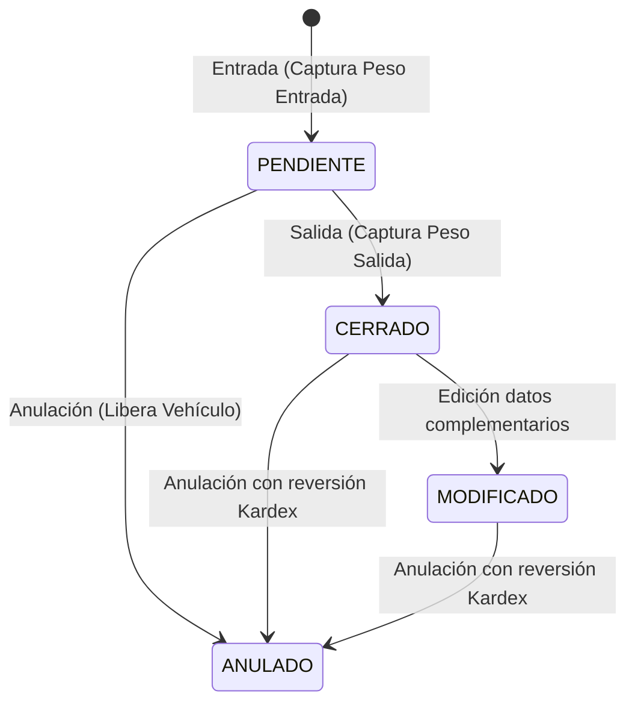

# CICLO DE PESAJE, ESTADOS DEL BOLETO E INVARIABLES METROLÓGICAS

Reglas del modelo de dominio de boletos de pesaje en BALANSOFT-WS.

---

## 1. Estados del Boleto (`BoletoPesaje.estado`)

### Reglas de Estado:
1. **PENDIENTE:** El vehículo está dentro de la planta cargando o descargando. Su placa queda bloqueada para nuevos pesajes.
2. **CERRADO:** El vehículo completó el pesaje de salida, se calcula el peso neto y se asienta el movimiento en Kardex.
3. **MODIFICADO:** Solo se permiten modificaciones a metadatos (producto, chofer, almacén, observaciones, guía). **El peso de la báscula no se puede modificar.** Se guarda un registro histórico en `boletos_ediciones` con el usuario responsable y motivo.
4. **ANULADO:** Requiere `motivo_anulacion` obligatorio. Si el boleto estaba cerrado, genera el contra-asiento en Kardex.

---

## 2. Invariables de Negocio

- **Prohibido dos boletos pendientes para el mismo vehículo:**
  Un camión solo puede tener un proceso de pesaje abierto simultáneamente. Si se intenta abrir otro, la API retorna error 400.
- **Tolerancia y Desviación con Peso Declarado:**
  $$\text{Diferencia} = \text{Peso Neto Real} - \text{Peso Declarado}$$
  $$\text{Porcentaje Desviación} = \left(\frac{\text{Diferencia}}{\text{Peso Declarado}}\right) \times 100$$
  Permite detectar robos en carretera, evaporación de granos o fugas de líquidos.
