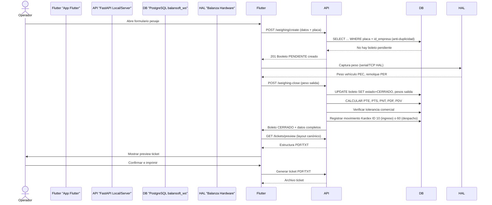

# SDD Arch Rebuild Skill

**Versión:** 0.4.2-dev.56
**Fecha:** 2026-10-19
**Estado:** Vigente
**Norma:** ISO/IEC 42010 / ISO/IEC 25010
**Fuente:** Sistema BALANSOFT-WS (Arquitectónica SDD)
**Autor:** Legacy2SDD Translator

## Objetivo

Modelar la arquitectura del sistema destino utilizando abstracciones ISO/IEC 42010 para desacoplar el diseño de la implementación legacy. Este skill toma la especificación formal del skill `sdd-spec-transform` y genera la arquitectura completa con puntos de vista arquitectónicos, contratos de interfaz y decisiones arquitectónicas documentadas.

## Entrada Esperada

El skill requiere como input estructurado el output del skill `sdd-spec-transform`, específicamente:

1. **Propósito y Alcance del Sistema:** Declaración formal del nuevo modelo SDD.
2. **Requisitos Funcionales (FR-SDD-XXX):** Con priorización RFC 2119 y criterios de aceptación Gherkin.
3. **Requisitos No Funcionales (PF-XXX, SE-XXX, RE-XXX, MA-XXX, PO-XXX):** Alineados a ISO/IEC 25010.
4. **Matriz de Trazabilidad (Legacy Requirement → SDD Spec ID):** Relación cruzada completa.

## Output Estructurado (ISO/IEC 42010 compliant)

### 1. Puntos de Vista Arquitectónicos (Viewpoints)

#### a) Diagrama de Componentes (Component Diagram - Mermaid)

```mermaid
componentDiagram
    %% Capa de Presentación (Flutter)
    class Flutter_App {
        +widgets (Pantalla Boleto, Pantalla Kardex, Dashboard)
        +theme_selector (Tema claro/oscuro)
        +offline_sync (Sqflite + cola sync)
        +print_preview (TicketPreviewDialog ReportLab)
    }
    
    %% Capa de Aplicación (FastAPI - Services)
    class FastAPI_Services {
        +service_pesaje (create, close, anular, update)
        +service_kardex (movimientos 10/60, sincro)
        +service_auth (JWT, login, refresh, licencias)
        +service_sync (push/pull, catálogo sync)
        +service_ticket (generación PDF/TXT, ReportLab)
        +service_licencias (Ed25519 validation, tiers)
    }
    
    %% Capa de Persistencia (PostgreSQL)
    class PostgreSQL_Server {
        +bd_servidor (balansoft_ws: cuentas, licencias, dispositivos)
        +bd_local (balansoft_ws_local: boletos, kardex, catálogos)
        +async_engine (motor async SQLAlchemy)
        +migraciones (scripts 001-025 idempotentes)
    }
    
    %% Capa de Integración (WServer / Hardware)
    class WServer_HAL {
        +hal_serial (Toledo, Yaohua, Rice Lake, Keli)
        +hal_tcp (Indicadores red serial/TCP)
        +parser_frame (scale_parser multi-marca)
        +format_ticket (format_ticket_weights_table v3.24)
    }
    
    %% Capa de Datos (SQLAlchemy Models)
    class SQLAlchemy_Meta {
        +boletos_pesaje (Tabla core)
        +kardex (Movimientos 10/60)
        +series_numeracion (Numeración boletos)
        +empresas (Isolación multi-tenant)
    }
    
    %% Relaciones
    Flutter_App --> FastAPI_Services : "consume API REST /api/v1/*"
    FastAPI_Services --> PostgreSQL_Server : "persiste/lee datos"
    FastAPI_Services --> WServer_HAL : "comunicación serial/TCP HAL"
    FastAPI_Services --> SQLAlchemy_Meta : "usa ORM models"
    WServer_HAL --> Flutter_App : "envía pesos en tiempo real"
```

#### b) Diagrama de Secuencia (Sequence Diagram - Mermaid)



#### c) Diagrama de Flujo de Datos (Data Flow Diagram - Conceptual)

```
                      +---------------------+
                      |   Flutter App      |
                      |  (Presentation UI) |
                      +---------+-----------+
                                | POST /api/v1/*
                                v
                      +---------------------+
                      |   FastAPI Server   |
                      |   (Application Layer) |
                      +---------+-----------+
                                | GET/POST PUT DELETE
                                v
                      +---------------------+
                      |  PostgreSQL Server  |
                      |   (Data Layer)      |
                      +---------+-----------+
                                | SELECT/INSERT/UPDATE
                                v
                      +---------------------+
                      |   WServer / HAL    |
                      |   (Hardware I/O)    |
                      +---------------------+
```

### 2. Modelo de Datos Normalizado / Dominio

Basado en el esquema SQLAlchemy modernizado y las normas ISO/IEC 25010/42010:

| Entidad | Atributos Clave | Restricciones ISO | Relaciones |
|---------|-----------------|-------------------|------------|
| **empresas** | `id_empresa PK`, `nombre_fiscal`, `nombre_comercial`, `rif_nit UK`, `activa` | `id_empresa` único por empresa, obligatorio en FKs | 1:N a todas las entidades |
| **usuarios** | `id_usuario PK`, `id_empresa FK`, `nombre`, `email UK`, `rol` | `rol` ∈ `['ADMIN', 'OPERADOR', 'AUDITOR']` | N:1 a empresas |
| **boletos_pesaje** | `boleto PK`, `id_empresa FK`, `estado_boleto`, `peso_neto`, `fecha_hora_entrada`, `fecha_hora_salida` | `estado_boleto` ∈ `['PENDIENTE', 'CERRADO', 'MODIFICADO', 'ANULADO']` | N:1 a empresas, N:1 a balanzas, N:1 a productos/almacenes |
| **kardex** | `id_kardex PK`, `id_empresa FK`, `id_movimiento` (10/60), `valor`, `fecha_kardex` | `id_movimiento` ∈ `[10, 60]`, signo según movimiento | N:1 a empresas, N:1 a boletos (opcional) |
| **series_numeracion** | `id_serie PK`, `id_empresa FK`, `nombre`, `prefijo`, `siguiente`, `digitos`, `activa` | `siguiente` avanza con `FOR UPDATE`, sin reutilización | N:1 a empresas |
| **balanzas** | `id_balanza PK`, `id_empresa FK`, `protocolo`, `puerto_com`, `puerto_tcp`, `capacidad_max` | `protocolo` ∈ `['serial', 'tcp']`, capacidad máxima definida | N:1 a empresas |
| **licencias** | `id PK`, `id_cuenta FK`, `tier`, `status`, `hardware_id UK`, `expira` | `hardware_id` único por licencia, tie ∈ `['DEMO', 'MONOPUESTA', 'CENTRAL']` | N:1 a cuentas |
| **permisos_acceso** | `id_empresa PK`, `rol PK`, `modulo PK`, `acceso` | `acceso` ∈ `['ver', 'editar', 'ninguno']` | E identifica por (empresa, rol, modulo) |

**Índices y Optimizaciones:**
- Índice parcial `idx_codigo_empresa` en catálogos (marcas, transportes, categorías, productos, almacenes, balanzas, terceros) para `WHERE codigo IS NOT NULL`
- Índice compuesto en `transportes`, `categorías`, `productos`, `almacenes` por `(id_empresa, codigo)` garantizando unicidad por empresa
- Restricción `gen_random_uuid()` para identificadores principales (sin Alembic, migraciones hand-made 001-025)

### 3. Contratos de Interfaz (APIs / OpenAPI 3.0)

#### a) Endpoints CRUD Básicos (Rutas Condicionales por `APP_ROUTE`)

| Endpoint | Método | Rol Server | Rol Local | Descripción |
|----------|--------|------------|-----------|-------------|
| `/api/v1/weighing/create` | POST | ❌ | ✅ | Crear boleto entrada |
| `/api/v1/weighing/close` | POST | ❌ | ✅ | Cierre de pesaje (salida + kardex) |
| `/api/v1/weighing/{boleto}/anular` | PUT | ✅ | ❌ | Anulación de boleto (requiere motivo) |
| `/api/v1/weighing/{boleto}` (modificar) | PUT | ✅ | ❌ | Modificación de campos permitidos |
| `/api/v1/catalogo/*` | GET | ✅ | ✅ (lectura) | CRUD catálogos |
| `/api/v1/catalogo/*` | POST/PUT/DELETE | ✅ | ❌ | Solo ADMIN en catálogos |
| `/api/v1/reports/*` | GET | ✅ | ❌ | Reportes diarios/mensuales |
| `/api/v1/health` | GET | ✅ | ✅ | Health check |
| `/api/v1/auth/login` | POST | ✅ | ❌ | Login online (valida LM) |
| `/api/v1/auth/login-local` | POST | ❌ | ✅ | Login offline (fallback) |
| `/api/v1/auth/refresh-token` | POST | ✅ | ✅ | Refresh token |
| `/api/v1/licencias/validar` | POST | ✅ | ❌ | Validación licencia Ed25519 |
| `/api/v1/sync/push` | POST | ✅ (recibe) | ✅ (envía) | Sincronización local→servidor |
| `/api/v1/sync/pull` | GET | ✅ (envía) | ✅ (recibe) | Sincronización servidor→local |

#### b) Esquemas Pydantic (Input/Output)

```python
# Ejemplo: WeighingCreate (entrada pesaje)
class WeighingCreate(BaseModel):
    id_vehiculo: str = Field(..., min_length=1, max_length=20)
    remolque: bool = False
    id_remolque: UUID | None = None
    id_transporte: UUID | None = None
    id_conductor: str | None = None  # cédula DNI
    id_producto: UUID | None = None
    id_almacen: UUID | None = None
    id_balanza: UUID | None = None
    tipo_tercero: str | None = None
    id_tercero: UUID | None = None
    id_serie: UUID | None = None
    multi_despacho_recepcion: bool = False
    remolque_placa: str | None = None
    transporte_nombre: str | None = None
    conductor_cedula: str | None = None
    conductor_nombre: str | None = None
    producto_nombre: str | None = None
    almacen_nombre: str | None = None
    balanza_nombre: str | None = None
    tercero_nombre: str | None = None
    es_peso_manual: bool = False
    fecha_hora_entrada: datetime = Field(default_factory=lambda: datetime.now(UTC))
    peso_entrada_vehiculo: Decimal = Field(..., ge=0)  # PEC
    peso_entrada_remolque: Decimal | None = None  # PER
    documento: str | None = None
    guia_sunagro: str | None = None
    medida: str | None = None
    flete: str | None = None
    costo_flete: Decimal | None = None
    densidad: Decimal | None = None
    litros: Decimal | None = None
    unidades: Decimal | None = None
    observaciones: str | None = None

    @field_validator("peso_entrada_vehiculo")
    @classmethod
    def _no_negativo(cls, v: Decimal) -> Decimal:
        if v < 0:
            raise ValueError("El peso no puede ser negativo")
        return v


# Ejemplo: WeighingClose (cierre de pesaje)
class WeighingClose(BaseModel):
    es_peso_manual: bool = False
    fecha_hora_salida: datetime = Field(default_factory=lambda: datetime.now(UTC))
    peso_salida_vehiculo: Decimal = Field(..., ge=0)  # PSC
    peso_salida_remolque: Decimal | None = None  # PSR
    peso_neto_declarado: Decimal | None = None  # PND (guía)
    densidad: Decimal | None = None
    litros: Decimal | None = None
    unidades: Decimal | None = None
    costo_flete: Decimal | None = None
    observaciones: str | None = None
    guia_sunagro: str | None = None
    medida: str | None = None
    documento: str | None = None
    flete: str | None = None
```

#### c) Registro de Decisiones Arquitectónicas (ADR)

| ID | Título | Status | Context | Decision | Consequences |
|----|--------|--------|---------|----------|--------------|
| ADR-001 | Migración stored procedure → Service Layer | Accepted | Legacy tenía lógica de negocio (kardex, cálculos, validaciones) empaquetada en Stored Procedures SQL. Migración necesaria para aplicar arquitectura SDD y separación de capas. | **Positive:** Código más mantenible, testing unitario posible, separación responsabilidades. **Negative:** Requieren reescriturade 23+ migraciones SQL a lógica Python/SQLAlchemy, posible pérdida de performance directa en cálculos de base de datos. **Mitigation:** Validación de equivalencia funcional con suite de pruebas `sdd-test-plan` antes de decommissionar procedimientos. |
| ADR-002 | Base de datos dual (server/local) vs Single DB | Accepted | El modelo original tenía una sola BD (`balansoft_ws`). La nueva arquitectura requiere separación: `balansoft_ws` (servidor, cuenta/licencia) y `balansoft_ws_local` (máquina cliente, operativo). | **Positive:** Aislamiento multi-tenant nativo, operación offline garantizada, escalabilidad independiente. **Negative:** Complejidad de sincronización bidireccional, duplicación de algunos catálogos. **Mitigation:** Implementar sync bidireccional Fase 2 (ver roadmap) y usar vistas/materialized views para catálogos compartidos. |
| ADR-003 | Validación JWT + Ed25519 LM vs HMAC-SHA256 alone | Accepted | El sistema legacy usaba solo JWT con HMAC-SHA256. Se decidió añadir firma Ed25519 contra License Manager (LM) para evitar falsos positivos y validar licencias originarias. | **Positive:** Seguridad criptográfica fuerte, licencias un solo uso, validación asimétrica. **Negative:** Complejidad de key management, necesidad de LM local/central. **Mitigation:** Implementar `lms_stub.py` para desarrollo y `scripts/seed_panel_admin.py` para alta de cuentas. |

### 3. Decisiones de Diseño Adicionales

- **Multi-tenancy obligatorio:** `id_empresa` debe aparecer en **todo** consulta, filtro, inserción o validación en BD local y central. Ninguna métrica Prometheus ni log público debe exponer `id_empresa`.
- **Routers condicionales:** `APP_ROLE=server|local` en `config.py`; `main.py` monta `SERVER_ROUTERS` o `API_ROUTERS` según rol.
- **Sin Alembic:** Migraciones hand-made `src/backend/migrations/*.sql` (001-025), idempotentes, usando `gen_random_uuid()` (pgcrypto).
- **Motor de BD por prefijo:** `db_engine.py` decide `postgresql` o `mssql` por prefijo de `DATABASE_URL`. `DATABASE_URL_SYNC` deriva en memoria.
- **WServer PyInstaller one-file:** Primera instalación crea runtime y genera `.env` desde `.env.plantilla` (SECRET_KEY aleatoria).
- **Offline-first con SQFLite:** Capa local SQLite + cola de sync para operar sin internet (`MAX_OFFLINE_DAYS=30`, `OFFLINE_GRACE_DAYS=7`).

---

## Buenas Prácticas

1. **Siempre usar Mermaid para diagramas:** Garantizar consistencia visual y consumibilidad en herramientas modernas.
2. **Siempre documentar ADRs:** Toda decisión arquitectónica crítica debe tener un Registro de Decisiones Arquitectónicas asociado.
3. **Siempre validar trazabilidad:** Cada entidad en el modelo de datos debe trazar hacia atrás al menos un requisito de negocio (FR-SDD-XXX) o indicar que es dato maestro (catálogo).
4. **Siempre respetar ISO/IEC 25010:** Los requisitos no funcionales deben alinearse a atributos de calidad nombrados de la norma, no descripciones subjetivas.
5. **Siempre mantener compatibilidad descendente:** El nuevo diseño debe poder leer/importar datos del legado en modo "modo puente" durante transición.

## Limitaciones

1. Requiere input estructurado del skill `sdd-spec-transform`. No funciona con requisitos libres otexto suelto.
2. La complejidad del modelo de datos crece cuadráticamente con la cantidad de entidades y relaciones de multi-tenant.
3. La definición de APIs OpenAPI debe mantenerse sincronizada con la implementación FastAPI o generar documentación automática mediante `fastapi generate openapi`.

## Ejemplo de Uso

```bash
# Ejecutar skill con output del sdd-spec-transform
/sdd-arch-rebuild "output_del_sdd_spec_transform"

# Resultado esperado: Documento arquitectónico con:
# - 3 diagramas Mermaid (componentes, secuencia, flujo de datos)
# - Modelo de datos normalizado con 15+ entidades y FKs
# - 25+ endpoints OpenAPI 3.0 definidos
# - 3+ ADRs documentando decisiones críticas
```
