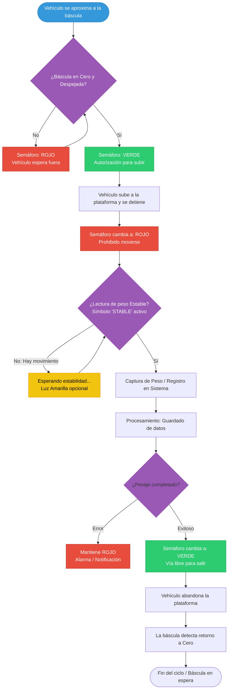

---

# Integración del semáforo en BALANSOFT-WS

> **Contrato:** el semáforo **no mide: obedece**. *La app es la dueña de la
> decisión* — BALANSOFT-WS calcula el LED a partir del peso en vivo de la
> báscula vinculada y del estado del boleto, y le envía al equipo **solo el
> cambio** de luz. El dispositivo (real o el simulador **BSDD**) es pasivo.

Dispositivo del módulo **Dispositivos** (`app_sidebar` → *Dispositivos de
Campo*), junto a las básculas: se registra en la tabla **`semaforos`**
(migración `026_semaforos`, gemela de `balanzas`), se vincula opcionalmente a
una báscula (`id_balanza`) y, si el *control automático* está activo, el
backend mantiene un **vigilante** por semáforo.

## 1. Canales soportados

El **mismo JSON de comandos** viaja por todos los canales; el transporte lo
resuelve `app/core/semaforo_hal.py` (`get_semaforo_hal`):

| Canal | Fase | Comando | Estado |
|-------|------|---------|--------|
| HTTP/REST | **2 (implementado)** | `POST http://{ip}:{puerto}/api/semaforo` | `GET` mismo endpoint (SPEC §3) |
| USB serie CDC-ACM | **3 (implementado)** | `/dev/bsdd_semaforo_acm` (default 9600 8N1), línea JSON + `\n` | una línea JSON |
| Modbus TCP | 4 (diferido) | `127.0.0.1:5020` FC05; bobinas `0=rojo, 1=amarillo, 2=verde, 3=zumbador, 10=demo, 11=reset` | FC01 |
| MQTT | 5 (diferido) | `127.0.0.1:1883`, tópico `semaforo/cmd` | tópico `semaforo/estado` |

La configuración `protocolo` ∈ `http | serial` decide el HAL: `http` usa
`ip_address`/`puerto_tcp` (default `127.0.0.1:8080`); `serial` usa
`puerto_com`/`baudrate`.

## 2. Contrato de comandos (idéntico en todos los canales)

```json
{"color":"rojo","action":"on"}
{"color":"verde","action":"on"}
{"color":"amarillo","action":"flash"}
{"zumbador":"on"}
{"all":"off"}
{"reset":true}
{"rojo":true}
{"verde":"flash"}
```

`color` ∈ `rojo|amarillo|verde` (alias `luz`), `action` ∈ `on|off|flash`,
`zumbador` ∈ `on|off` (se acepta booleano y se normaliza), `all` solo admite
`off`. Un `color` sin `action` equivale a `"on"`. Se aceptan además los
**atajos planos** por color del SPEC §5.6 — `{"rojo":true}` (fijo),
`{"rojo":false}` (apagado), `{"verde":"flash"}` (intermitente) — y pueden
combinarse con `zumbador` (`{"rojo":true,"zumbador":true}`); la forma canónica
tiene prioridad si conviven. `normalizar_comando()` (`semaforo_hal.py`) valida,
limpia y **canoniza** (`color`+`action`) el payload antes de enviarlo por el
canal; un comando sin claves reconocidas es `422`.

## 3. Estado publicado por el equipo (SPEC §3)

```json
{"rojo":{"encendido":true,"modo":"fijo"},
 "amarillo":{"encendido":false,"modo":"apagado"},
 "verde":{"encendido":false,"modo":"apagado"},
 "zumbador":false, "fase":"EXTERNO", "automatico":false,
 "timestamp":"2026-10-19T12:00:00Z"}
```

`modo` ∈ `apagado | fijo | intermitente`; `fase` es la del autómata del equipo
(8 fases + `EXTERNO`) y `automatico` solo es `true` en el **modo demo** del
simulador. BSDD solo lo **publica**; la decisión que BALANSOFT-WS impone es la
de §4.

## 4. Fases y luces decididas por la app

`decidir_semaforo(ContextoSemaforo)` es una **función pura** (fácil de probar)
con este orden de precedencia:

| Fase | Condición | Luces |
|------|-----------|-------|
| `SIN_BALANZA` | sin lectura viva de la báscula | ROJO fijo |
| `SALIDA` | último boleto `CERRADO`/`MODIFICADO`, sin pendientes y con `fecha_hora_salida` | VERDE fijo |
| `AUTORIZADO` | peso ≤ `umbral_cero_kg` y sin boleto pendiente | VERDE fijo |
| `ESPERANDO` | peso ≤ `umbral_cero_kg` con boleto pendiente | ROJO fijo |
| `INESTABLE` | peso > umbral y lectura inestable | ROJO fijo + AMARILLO intermitente |
| `PESANDO` | peso > umbral y lectura estable | ROJO fijo |

`umbral_cero_kg` (default `5.0`) separa "plataforma libre" de "vehículo sobre
la plataforma". La salida se concede por **estado del último boleto**, no por
ventana de tiempo.

## 5. Superficie REST (rol local)

| Método | Ruta | Rol | Descripción |
|--------|------|-----|-------------|
| `GET` | `/api/v1/semaforos` | operador | Lista los semáforos de la empresa |
| `POST` | `/api/v1/semaforos` | ADMIN | Alta (valida canal y báscula) |
| `PUT` | `/api/v1/semaforos/{id}` | ADMIN | Edición (reinicia el vigilante) |
| `DELETE` | `/api/v1/semaforos/{id}` | ADMIN | Baja (detiene el vigilante) |
| `GET` | `/api/v1/semaforos/descubrir` | operador | Escaneo HTTP + serie (`incluir_simulados=true` por defecto) |
| `POST` | `/api/v1/semaforos/{id}/probar` | operador | Lee el estado publicado (diagnóstico) |
| `GET` | `/api/v1/semaforos/{id}/estado` | operador | Estado del equipo + fase/luces de la app |
| `POST` | `/api/v1/semaforos/{id}/comando` | operador | Comando manual (banco de pruebas; se audita) |
| `POST` | `/api/v1/semaforos/{id}/automatico` | operador | Activa/desactiva el control automático |

Todas las rutas filtran por `id_empresa` (aislamiento multi-tenant) y las de
escritura exigen `require_admin` salvo el comando manual y el interruptor de
control automático. El control automático **exige** una `id_balanza` vinculada
(400 si falta) y `POST /comando` deja registro de auditoría (`accion=COMANDO`).

## 6. Vigilante (`SemaforoController`)

- Un `asyncio.Task` por semáforo con control automático, cadencia de **0.5 s**.
- Lee el peso/estabilidad de la **sesión persistente del HAL de balanza**
  (`ScaleSessionManager`), el estado del boleto y decide; manda al equipo
  **solo las diferencias** (`Luces.diferencias`).
- Si el envío falla, **no** actualiza su seguimiento en memoria y reintenta el
  mismo cambio en el siguiente ciclo (sin inundar el equipo).
- Arranca en el `lifespan` de `app/main.py` (`asegurar_activos`) y se detiene al
  apagar (`detener_todas`). Alta/edición/baja y el interruptor de automático lo
  arrancan/paran en caliente.
- Un comando **manual no** cambia el modo automático: si el vigilante está
  activo, en el siguiente ciclo vuelve a imponer la luz del pesaje (el manual es
  banco de pruebas *y* override momentáneo).

## 7. Descubrimiento

`GET /semaforos/descubrir` prueba en paralelo:

- **HTTP/REST**: el simulador BSDD local `127.0.0.1:8080` y las direcciones ya
  registradas por la empresa.
- **Serie**: `/dev/bsdd_semaforo_acm`, los puertos USB-serie reales
  (`serial.tools.list_ports`, se omiten los `/dev/ttyS*`) y los ptys/sockets
  virtuales de `BSDD_SEMAFORO_SERIAL_GLOBS` (default
  `/dev/bsdd_semaforo_*,/tmp/bsdd_semaforo*,/tmp/ttyV*`) — un candidato de glob
  solo se prueba si existe y es pty/socket (o es la ruta BSDD), nunca un archivo
  cualquiera.

Solo se devuelven los que responden con el JSON de estado del SPEC; los ya
registrados se omiten. En la UI, **Detectar** auto-registra los nuevos (aparece
`SIMULADA` cuando es el simulador), igual que en básculas.

## 8. Concurrencia y seguridad

- El puerto serie se protege con un `threading.Lock` **por ruta**, aplicado
  dentro del hilo de `asyncio.to_thread` (regla
  `.agents/rules/hardware-io-concurrency.md`), porque comando + lectura de
  estado concurrentes sobre el mismo pty rompen la lectura.
- Los comandos y los cambios de modo se **auditan** (usuario, IP, timestamp
  UTC); el peso capturado de la báscula nunca se toca (el semáforo es solo
  salida).
- La UI muestra la fase/luces que decide la app y permite el banco de pruebas
  manual; **no** decide el LED.

## 9. Verificación

- `backend/tests/test_semaforo_hal.py` — contrato de comandos, HTTP
  (`httpx.MockTransport`) y serie (pty real).
- `backend/tests/test_semaforo_service.py` — matriz de decisión pura, diffs de
  luces y ciclo del vigilante.
- `backend/tests/test_semaforos_api.py` — CRUD, aislamiento tenant,
  `probar`/`estado`, comandos (422), automático y descubrimiento con pty.
- `frontend/test/widget/semaforos_tab_test.dart` — pestaña de semáforos y envío
  de comandos manuales desde la UI.
