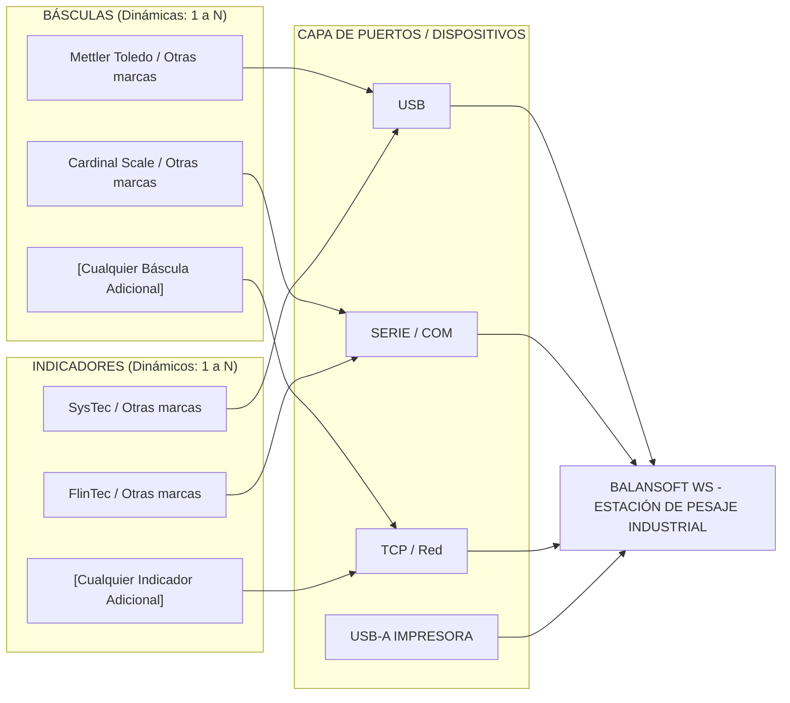
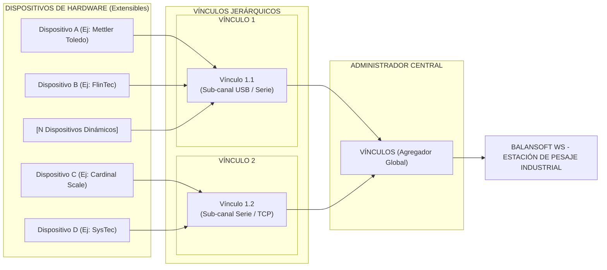

### 1. Diagrama Completo de Detección Dinámica de Dispositivos y Puertos

Este diagrama modela cómo el sistema detecta de forma abierta cualquier báscula, indicador o periférico a través de múltiples canales físicos o de red hacia la aplicación principal.

---

### 2. Diagrama Completo de Conexión por Vínculos Jerárquicos (Ej. 1.1)

Este diagrama refleja la estructura de interconexión donde los dispositivos se agrupan en sub-vínculos jerárquicos (ej. **Vínculo 1.1**, **Vínculo 1.2**), permitiendo una gestión modular y escalable para el motor de la estación de pesaje.

