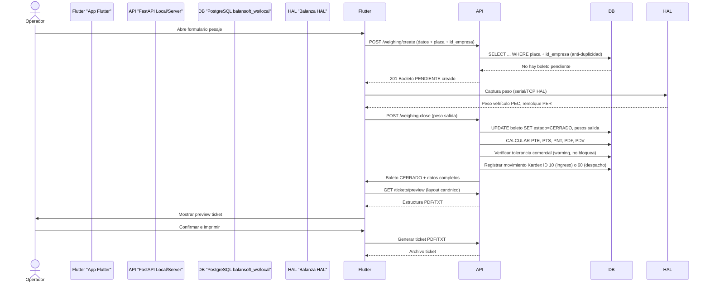

# Descripción General de Arquitectura — BALANSOFT-WS

**Norma:** ISO/IEC/IEEE 42010 - Arquitectura de sistemas y software

## 1. Propósito

Este documento describe la arquitectura del sistema BALANSOFT-WS, definiendo los componentes, sus relaciones, las partes interesadas y las preocupaciones (concerns) atendidas. La arquitectura está diseñada para satisfacer los requisitos de pesaje industrial, multi-tenancy, offline-first y metrología legal especificado en el SRS (ISO/IEC 29148).

## 2. Partes Interesadas y Concerns

| Parte Interesada | Concern Principal | Abordaje Arquitectónico |
|------------------|-------------------|------------------------|
| **Operador** | Precisión del peso, facilidad de uso, modo offline | Capa HAL aislada, atajos de teclado, offline-first con sincronización |
| **Administrador** | Gestión de licencias, catálogos, seguridad | Routers condicionales por `APP_ROLE`, matriz de permisos 18×3, validación Ed25519 |
| **Supervisor** | Auditoría, integridad metrológica, estados de bolete | Middleware de auditoría, control de estados PENDIENTE→CERRADO→MODIFICADO→ANULADO |
| **TI / Infraestructura** | Despliegue dual BD, rendimiento, paginación | Arquitectura server/local, pagination helper `_enriquecer_pesajes_lista` |
| **License Manager** | Validación Ed25519, tiers, expiración | Servicio `LicenseService` con firma asimétrica, caché offline |
| **Hardware báscula** | Compatibilidad multi-marca, fiabilidad, checksum | Capa HAL multi-marca, timeouts acotados, framing configurables |
| **Empresas transportistas** | Facturación, reportes, impresiones | Endpoints de reporte, generación PDF/TCS con ReportLab, tabla canónica 5 columnas |

## 3. Visión General del Sistema

### 3.1 Arquitectura de Capas

```
+----------------------+       +----------------------+
|  Presentación (Flutter) | <--> |  Aplicación (FastAPI) |
|  - BLoC / Estado     |       |  - Servicios de dominio |
|  - Pantallas         |       |  - Endpoints API       |
|  - Previsualización  |       |  - Contratos Pydantic  |
+----------------------+       +----------------------+
        |                            |
        | HTTP / JWT / Bearer       |
        v                            v
+----------------------+       +----------------------+
|  Persistencia (PostgreSQL) | <--> |  Hardware HAL        |
|  - 26+ tablas         |       |  - Multi-marca serial |
|  - id_empresa FK      |       |  - TCP/IP indicators  |
|  - SQLite local       |       +----------------------+
|  - sync_queue         |
+----------------------+
```

### 3.2 Modos de Operación por `APP_ROLE`

| Rol | Routers Montados | Responsabilidades |
|-----|------------------|-------------------|
| **`local`** | `API_ROUTERS` | Estación operativa: boletos, catálogos, login offline. WServer en `0.0.0.0:8000`. |
| **`server`** | `SERVER_ROUTERS` | Central de cuenta/licencia/sync/panel. WServer en `0.0.0.0:8002`. |

### 3.3 Arquitectura de Dos Bases de Datos

| Base de Datos | Propósito | Tecnología |
|---------------|-----------|------------|
| `balansoft_ws` | Servidor: cuentas, licencias, dispositivos, sincronización, panel | PostgreSQL 15+ |
| `balansoft_ws_local` | Máquina cliente: usuarios locales, flota, inventario, boletos, kardex, auditoría | PostgreSQL 15+ (o SQLite local para offline) |

**Regla fundamental:** Una máquina local = una empresa = una cuenta. El `id_empresa` se resuelve del JWT del usuario autenticado.

## 4. Componentes Principales

### 4.1 Capa de Presentación (Flutter / BLoC)
- **Responsabilidad**: Interfaz de usuario, experiencia de usuario, previsualización de tickets, modo kiosk
- **Tecnología**: Dart, BLoC, sqflite (offline-first), window_manager (modo kiosk)
- **Comunicación**: API REST `/api/v1/*` con autenticación JWT Bearer

### 4.2 Capa de Aplicación (FastAPI / Python)
- **Responsabilidad**: Lógica de dominio, servicios, validación de negocio, contratos API
- **Servicios clave**:
  - `WeighingService`: Crear, cerrar, anular, modificar boletos; cálculos PTE-PTS-PNT-PDF-PDV; kardex
  - `CatalogService`: CRUD catálogos (marcas, transportes, productos, almacenes, etc.)
  - `AuthService`: JWT authentication, license validation Ed25519, login local/offline
  - `SyncService`: Sincronización bidireccional local↔servidor, resolución de conflictos (último timestamp gana)
  - `ReportService`: Generación PDF/TXT de tickets, reportes diarios/mensuales, export Excel
  - `LicenseService`: Validación de licencias, emisión de llaves un solo uso, tiers DEMO/MONOPUESTA/CENTRAL

### 4.3 Capa de Persistencia (PostgreSQL / SQLite)
- **Responsabilidad**: Almacenamiento de datos, integridad, transacciones
- **Características**:
  - Migraciones hand-made (001-025), idempotentes, sin Alembic
  - Motor de BD por prefijo de `DATABASE_URL` (postgresql o mssql)
  - Restricciones `ON DELETE RESTRICT` en FK críticas
  - Índices composés por `(id_empresa, codigo)` en catálogos
  - `gen_random_uuid()` para identificadores principales

### 4.4 Capa de Integración Hardware (HAL)
- **Responsabilidad**: Abstracción de dispositivos de pesaje físicos
- **Protocolos soportados**: Serial RS-232/USB, TCP sockets, Bluetooth RFCOMM
- **Marcas compatibles**: Toledo, Yaohua, Rice Lake, Torrey, Keli, Epson, OKI
- **Framing**: Configurable (`lf`, `cr`, `crlf`, `stx_etx` con/without checksum)
- **Timeouts**: Lectura serie acotada (1.0s a 2.0s), `writer.wait_closed()` con timeout 2.0s

## 5. Diagramas Arquitectónicos

### 5.1 Diagrama de Componentes (ISO 42010 View)

Ver `architecture/views/logical-view.md` para la visión lógica detallada.

### 5.2 Diagrama de Secuencia (ISO 42010 View)

Flujo de creación y cierre de boleto de pesaje:



### 5.3 Diagrama de Despliegue (ISO 42010 View - Deployment)

- **Entorno de Producción**: WServer binario (PyInstaller one-file) en cada estación Linux/Windows
- **Entorno de Desarrollo**: `uvicorn app.main:app --port 8000` o `--port 8002` (rol server)
- **Base de Datos**: PostgreSQL 15+ corriendo en VPS (servidor) o máquina local (desarrollo/cliente)
- **Licencia Manager**: BALANSOFT-LM central (`https://lm.balansoft.com.ve/api/v1`) o local (`127.0.0.1:9001/api/v1`)
- **Red**: LAN para estaciones locales (`0.0.0.0:8000`), WAN para modo server remoto

## 6. Rationale de Decisiones Arquitectónicas

### 6.1 Arquitectura Server/Local Dual (ADR-002)

**Contexto**: El modelo original tenía una sola BD (`balansoft_ws`). La nueva arquitectura requiere separación para garantizar offline-first y multi-tenancy.

**Decision**: Separar la BD en `balansoft_ws` (servidor central, cuentas/licencia) y `balansoft_ws_local` (máquina del cliente, operación pura).

**Consequences Positivas**:
- Aislamiento multi-tenant nativo (`id_empresa` en toda consulta)
- Operación offline garantizada con SQFLite + sync_queue
- Escalabilidad independiente (central no depende de estaciones conectadas)

**Consequences Negativas**:
- Complejidad de sincronización bidireccional
- Duplicación de algunos catálogos entre BDs
- Consistencia eventual entre BDs

**Mitigation**: Implementar sync bidireccional Fase 2 (ver roadmap) y usar vistas/materialized views para catálogos compartidos. Decisión tomada en ADR-002.

### 6.2 Routers Condicionales por `APP_ROLE` (ADR-001)

**Contexto**: Necesidad de un solo repositorio de código que sirva tanto para estaciones operativas como para central de cuenta.

**Decision**: Una sola base de código FastAPI con routers condicionales basados en `APP_ROLE=server|local` en `.env`.

**Consequences Positivas**:
- Un solo repo, un solo `main.py`, un solo `pytest`
- Migrable a paquetes separados cuando crezca
- Mismo código base, comportamiento diferente según rol

**Consequences Negativas**:
- Condición `if settings.app_role` en `main.py` que debe mantenerse consistente
- Posible olvidar incluir un router en el rol incorrecto

**Mitigation**: Tests automatizados que verifican que `APP_ROLE=local` monta `API_ROUTERS` y `APP_ROLE=server` monta `SERVER_ROUTERS`. CI checks obligatorios.

### 6.3 Validación Ed25519 + HMAC-SHA256 (ADR-003)

**Contexto**: El sistema legacy usaba solo JWT con HMAC-SHA256. Riesgo de falsos positivos y licinas no originarias.

**Decision**: Añadir firma digital Ed25519 contra License Manager (LM) para validación de licencias originarias.

**Consequences Positivas**:
- Seguridad criptográfica fuerte (firmas asimétricas)
- Licencias un solo uso, imposibles de falsificar
- Validación contra LM local o central

**Consequences Negativas**:
- Complejidad de key management (claves públicas/privadas)
- Necesidad de LM local/central operativa
- Latencia adicional en validación de licencia

**Mitigation**: Implementar `lms_stub.py` para desarrollo y `scripts/seed_panel_admin.py` para alta de cuentas. Cacheo de validaciones exitosas por 24h.

## 7. Vistas ISO 42010

Para las vistas definidas por ISO/IEC/IEEE 42010, consulte:

- **Visión Lógica** (`architecture/views/logical-view.md`): Estructura de componentes, flujos de datos, interacciones
- **Visión de Despliegue** (`architecture/views/deployment-view.md`): Entornos, despliegue, configuración
- **Visión de Implementación** (`architecture/views/implementation-view.md`): Módulos, código, configuración

Estas vistas están disponibles en el directorio `architecture/views/`.